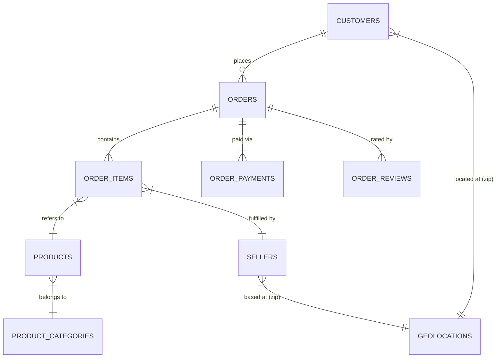

# Tài liệu Cơ sở dữ liệu (Database Documentation)

Tài liệu mô tả thiết kế SQLite database tại [`data/olist.db`](../data/olist.db) của dự án phân tích thương mại điện tử Olist Brazil (2016–2018).

---

## 1. Kiến trúc 3 tầng

```
data/processed/clean_*.csv
        ↓  [scripts/database/build_db.py]
  Staging Tables (stg_*)       ← Import nhanh từ CSV, không ràng buộc
        ↓  [sql/02_load_data.sql]
  Relational Tables (3NF)      ← Chuẩn hóa, FK constraints, Indexes
        ↓  [sql/03_queries.sql]
  Analytical Views             ← Tầng phân tích cho Notebook & Dashboard
```

---

## 2. Sơ đồ ERD



---

## 3. Mô tả các bảng

### Bảng 1: `customers`
| Cột | Kiểu | Khóa | Mô tả |
|---|---|---|---|
| `customer_id` | TEXT | **PK** | Mã phiên giao dịch (1 người có thể có nhiều ID) |
| `customer_unique_id` | TEXT | | Mã định danh thực sự của người dùng |
| `customer_zip_code_prefix` | INT | FK→geolocations | Mã bưu chính 5 chữ số |
| `customer_city` | TEXT | | Thành phố |
| `customer_state` | TEXT | | Bang (viết tắt 2 ký tự, ví dụ: SP, RJ) |

### Bảng 2: `orders` ⭐ (trung tâm)
| Cột | Kiểu | Khóa | Mô tả |
|---|---|---|---|
| `order_id` | TEXT | **PK** | Mã đơn hàng duy nhất |
| `customer_id` | TEXT | FK→customers | Khóa ngoại khách hàng |
| `order_status` | TEXT | | Trạng thái (chỉ giữ `delivered`) |
| `order_purchase_timestamp` | TEXT | | Thời điểm đặt hàng (ISO 8601) |
| `order_delivered_customer_date` | TEXT | | Ngày giao thực tế |
| `order_estimated_delivery_date` | TEXT | | Ngày giao dự kiến |
| `delivery_days` | REAL | | Số ngày giao hàng thực tế |
| `delay_days` | INT | | Số ngày trễ (âm = sớm hơn dự kiến) |
| `is_late` | INT | | 1 = trễ, 0 = đúng/sớm hạn |
| `purchase_year` | INT | | Năm mua (feature đã tính sẵn) |
| `purchase_month` | INT | | Tháng mua |
| `purchase_year_month` | TEXT | | "YYYY-MM" (dùng GROUP BY) |
| `purchase_weekday` | INT | | 0=Thứ 2 … 6=CN |
| `purchase_hour` | INT | | Giờ đặt hàng (0–23) |

### Bảng 3: `order_items`
| Cột | Kiểu | Khóa | Mô tả |
|---|---|---|---|
| `order_id` | TEXT | **PK (1/2)** FK→orders | |
| `order_item_id` | INT | **PK (2/2)** | Số thứ tự sản phẩm trong đơn |
| `product_id` | TEXT | FK→products | |
| `seller_id` | TEXT | FK→sellers | |
| `price` | REAL | | Giá sản phẩm (đã cap outlier IQR) |
| `freight_value` | REAL | | Phí vận chuyển |
| `item_total` | REAL | | `price + freight_value` |
| `is_price_outlier` | INT | | 1 = giá bị capping |

### Bảng 4: `order_payments`
| Cột | Kiểu | Khóa | Mô tả |
|---|---|---|---|
| `order_id` | TEXT | **PK (1/2)** FK→orders | |
| `payment_sequential` | INT | **PK (2/2)** | Thứ tự thanh toán (1 đơn có thể nhiều lần TT) |
| `payment_type` | TEXT | | credit_card / boleto / voucher / debit_card |
| `payment_installments` | INT | | Số kỳ trả góp |
| `payment_value` | REAL | | Giá trị thanh toán (BRL) |

### Bảng 5: `order_reviews`
| Cột | Kiểu | Khóa | Mô tả |
|---|---|---|---|
| `review_id` | TEXT | **PK** | |
| `order_id` | TEXT | FK→orders | |
| `review_score` | INT | | Điểm 1–5 ⭐ |
| `review_comment_title` | TEXT | | Tiêu đề (mặc định "No Title") |
| `review_comment_message` | TEXT | | Nội dung (mặc định "No Comment") |
| `has_comment` | INT | | 1 = có comment thực, 0 = không |

### Bảng 6: `products`
| Cột | Kiểu | Khóa | Mô tả |
|---|---|---|---|
| `product_id` | TEXT | **PK** | |
| `product_category_name` | TEXT | FK→product_categories | Tên danh mục (tiếng Bồ Đào Nha) |
| `product_weight_g` | REAL | | Trọng lượng (gram) |
| `product_volume_cm3` | REAL | | Thể tích (cm³) |

### Bảng 7: `sellers`
| Cột | Kiểu | Khóa | Mô tả |
|---|---|---|---|
| `seller_id` | TEXT | **PK** | |
| `seller_zip_code_prefix` | INT | FK→geolocations | |
| `seller_city` / `seller_state` | TEXT | | Địa chỉ người bán |

### Bảng 8: `product_categories`
| Cột | Kiểu | Khóa | Mô tả |
|---|---|---|---|
| `product_category_name` | TEXT | **PK** | Tên tiếng Bồ Đào Nha |
| `product_category_name_english` | TEXT | | Tên tiếng Anh |

### Bảng 9: `geolocations`
| Cột | Kiểu | Khóa | Mô tả |
|---|---|---|---|
| `zip_code_prefix` | INT | **PK** | Mã bưu chính (đại diện trung bình lat/lng) |
| `lat` / `lng` | REAL | | Tọa độ địa lý |
| `city` / `state` | TEXT | | Tên thành phố / bang |

---

## 4. Analytical Views

| View | Mục đích | Số dòng |
|---|---|---:|
| `view_order_clean` | JOIN toàn bộ 9 bảng → 1 view phân tích đầy đủ | ~110,186 |
| `v_sales_monthly` | Doanh thu + số đơn theo tháng | 22 tháng |
| `v_delivery_kpi` | Tỷ lệ trễ + avg delivery_days theo bang | 27 bang |
| `v_category_performance` | Doanh thu + review_score theo danh mục | 74 danh mục |
| `v_customer_rfm` | Recency / Frequency / Monetary per customer_unique_id | ~93,387 |
| `v_seller_performance` | Doanh thu + review theo người bán | 2,970 |
| `v_payment_mix` | Phân bố phương thức thanh toán | 4 loại |

---

## 5. Thống kê tổng quan

| Bảng | Số bản ghi |
|---|---:|
| customers | 96,469 |
| orders | 96,469 |
| order_items | 110,186 |
| order_payments | 100,744 |
| order_reviews | 95,329 |
| products | 32,214 |
| sellers | 2,970 |
| product_categories | 74 |
| geolocations | 19,010 |
| **TỔNG** | **553,465** |

**Kích thước file:** `olist.db` ~ 199.6 MB | **Indexes:** 15 | **Views:** 7

---

## 6. Cách kết nối & truy vấn

### Trong Jupyter Notebook:
```python
import sqlite3
import pandas as pd

conn = sqlite3.connect('../data/olist.db')

# Dung view tong hop (tuong duong view_pr_clean cua Group3)
df = pd.read_sql_query("SELECT * FROM view_order_clean LIMIT 5", conn)

# Lay du lieu phan tich san
df_rfm     = pd.read_sql_query("SELECT * FROM v_customer_rfm", conn)
df_sales   = pd.read_sql_query("SELECT * FROM v_sales_monthly ORDER BY purchase_year_month", conn)
df_kpi     = pd.read_sql_query("SELECT * FROM v_delivery_kpi ORDER BY late_rate_pct DESC", conn)
```

### Rebuild database:
```bash
python scripts/database/build_db.py
```

### Chạy health check:
```bash
python scripts/database/check_db.py
```

> Chạy các lệnh trên từ thư mục gốc `ADY291c-AI2107-Group2`. `build_db.py` sẽ xóa và tạo lại `data/olist.db`, sau đó nạp CSV, chuyển staging sang bảng quan hệ và tạo view.

---

## 7. Cấu trúc file SQL

| File | Nội dung |
|---|---|
| `sql/01_schema.sql` | DDL: 9 staging + 9 relational tables + 15 indexes + 6 views |
| `sql/02_load_data.sql` | DML: Transform staging → relational (theo thứ tự FK) |
| `sql/03_queries.sql` | Queries: Health check + 5 câu hỏi kinh doanh + ML features |

---

## 8. Công thức phân tích và cách chạy từng file

### Công thức

| Chỉ số | Cách tính trong dự án |
|---|---|
| Doanh thu | Cộng `payment_value` của mọi lần thanh toán trong từng đơn; sau đó cộng các đơn theo tháng. |
| Giá trị đơn trung bình (AOV) | Doanh thu mỗi tháng / số đơn có thanh toán. Trong SQL, tổng payment được gom về một dòng cho mỗi `order_id` trước khi lấy `AVG`. |
| Giao trễ | `is_late = 1` nếu giao sau ngày dự kiến; tỷ lệ trễ = số đơn trễ / số đơn có thông tin giao hàng. |
| RFM - Recency | Số ngày từ lần mua cuối của khách đến ngày sau ngày mua cuối cùng trong dataset. Mốc cố định này giúp so sánh khách hàng trong cùng snapshot. |
| RFM - Frequency | Số đơn (`order_id`) của khách; một khách được nhận diện bằng `customer_unique_id`. |
| RFM - Monetary | Tổng `payment_value` của các đơn khách đã thanh toán, trước tiên gom payment theo từng đơn. |

Các phép tính doanh thu, giao hàng và RFM trong `03_queries.sql` dùng mức dữ liệu mỗi đơn hàng. Không cộng `payment_value` hoặc tính tỷ lệ giao trễ trực tiếp trên `view_order_clean`: view này có nhiều dòng cho một đơn khi đơn chứa nhiều sản phẩm, nên có thể nhân lặp số liệu cấp đơn.

### Chạy theo luồng khuyến nghị

Mở PowerShell tại thư mục gốc dự án, cài dependencies một lần rồi dựng database:

```powershell
python -m pip install -r requirements.txt
python scripts/database/build_db.py
python scripts/database/check_db.py
```

`build_db.py` tự thực hiện đúng thứ tự: chạy `01_schema.sql` → đọc các CSV trong `data/processed/` vào staging → chạy `02_load_data.sql` → tạo `view_order_clean` từ `03_queries.sql`. Sau đó `check_db.py` kiểm tra bảng, view và tính toàn vẹn dữ liệu.

### Chạy riêng từng file SQL

Các lệnh dưới đây cần SQLite command-line (`sqlite3`) và chạy tại thư mục gốc:

```powershell
sqlite3 data/olist.db ".read sql/01_schema.sql"
```

Lệnh trên chỉ tạo bảng, index và sáu view nền; nó chưa nạp CSV.

`02_load_data.sql` chỉ chạy được sau khi đã có các bảng `stg_*` và dữ liệu CSV bên trong. Script `build_db.py` đảm nhiệm bước nạp staging bằng pandas. Nếu staging đã được nạp, có thể chạy chuyển đổi thủ công:

```powershell
sqlite3 data/olist.db ".read sql/02_load_data.sql"
```

Sau khi có dữ liệu quan hệ, chạy các truy vấn phân tích và tạo `view_order_clean`:

```powershell
sqlite3 data/olist.db ".read sql/03_queries.sql"
```

Lệnh cuối in kết quả các câu `SELECT` trong terminal. Khi chạy thông qua `build_db.py`, script chỉ trích lệnh tạo `view_order_clean`; các câu `SELECT` trong file không tự in kết quả. Để xem lại từng nhóm kết quả, chạy riêng câu SQL cần phân tích bằng SQLite CLI hoặc đọc view bằng Notebook, ví dụ:

```sql
SELECT * FROM v_sales_monthly ORDER BY purchase_year_month;
SELECT * FROM v_delivery_kpi ORDER BY late_rate_pct DESC;
SELECT * FROM v_customer_rfm ORDER BY monetary DESC LIMIT 20;
```

